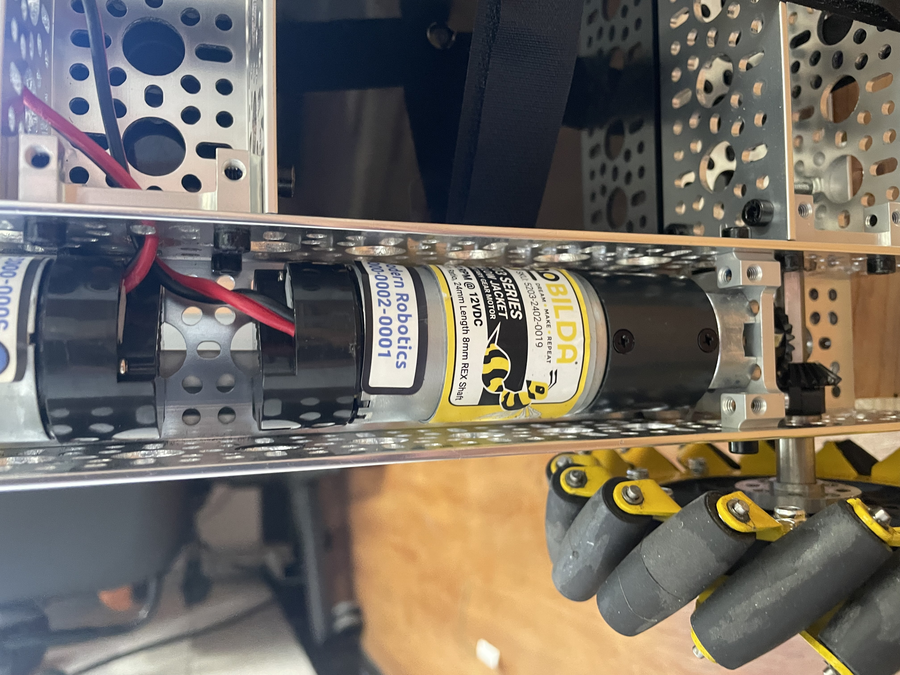
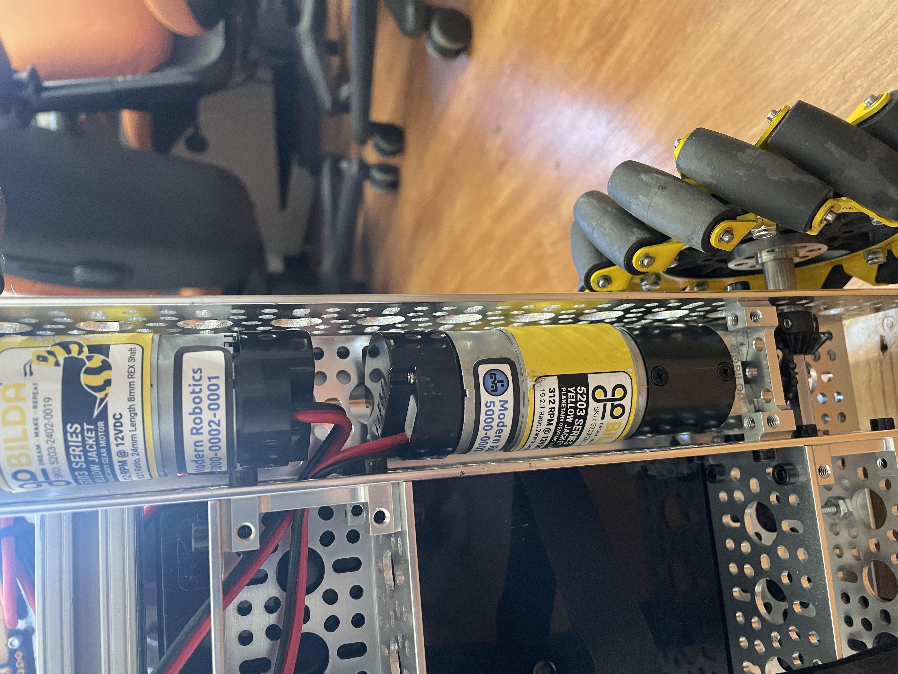
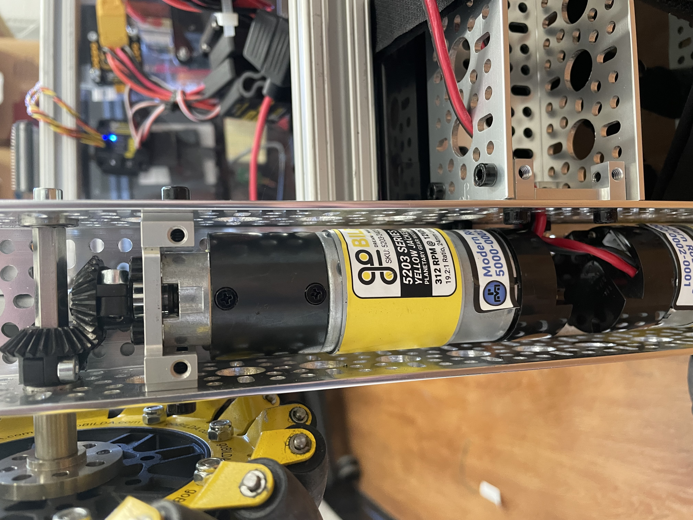
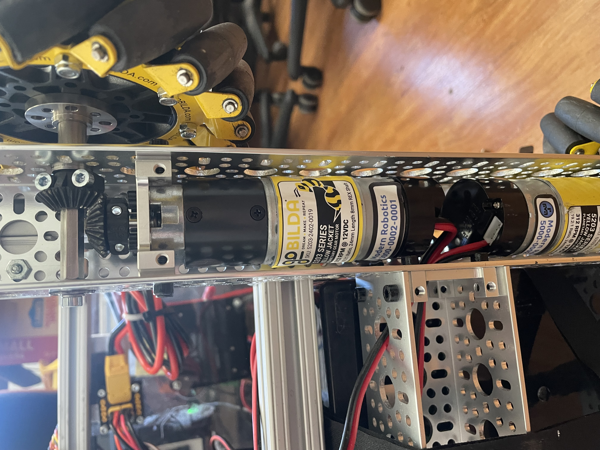
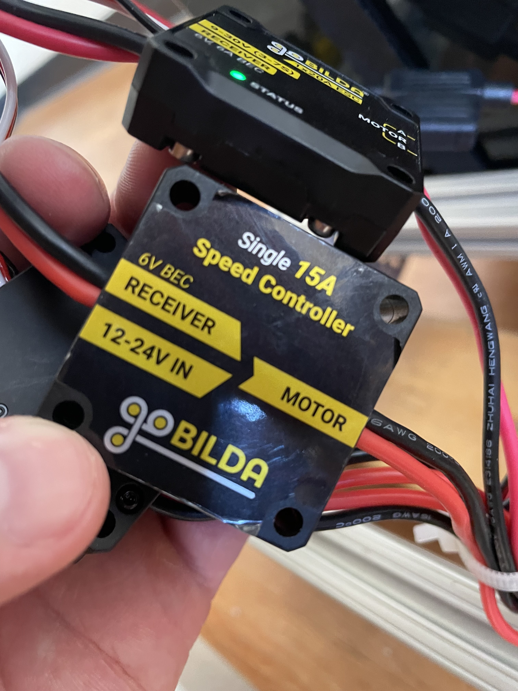
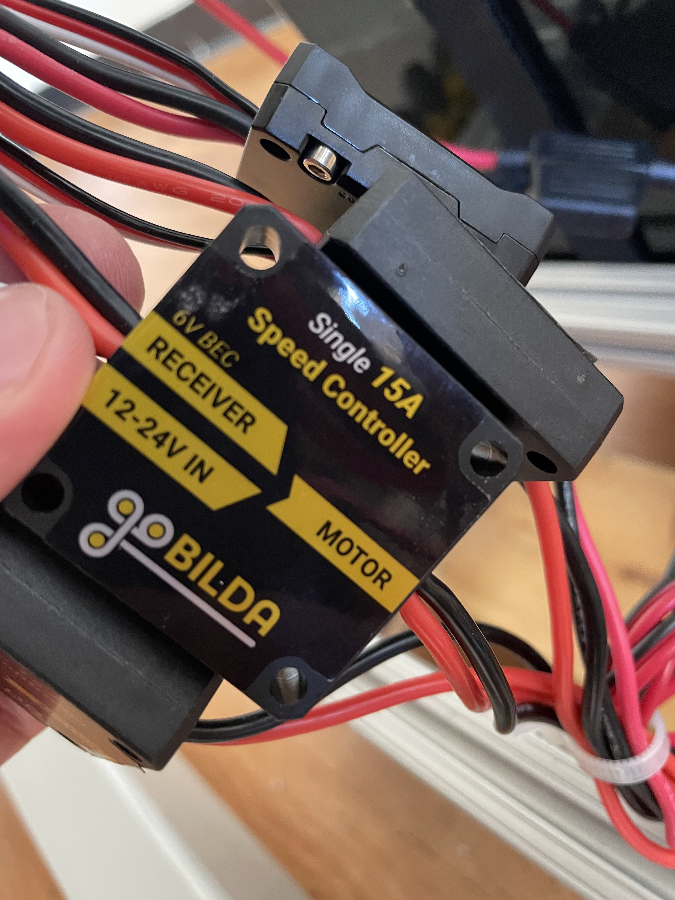
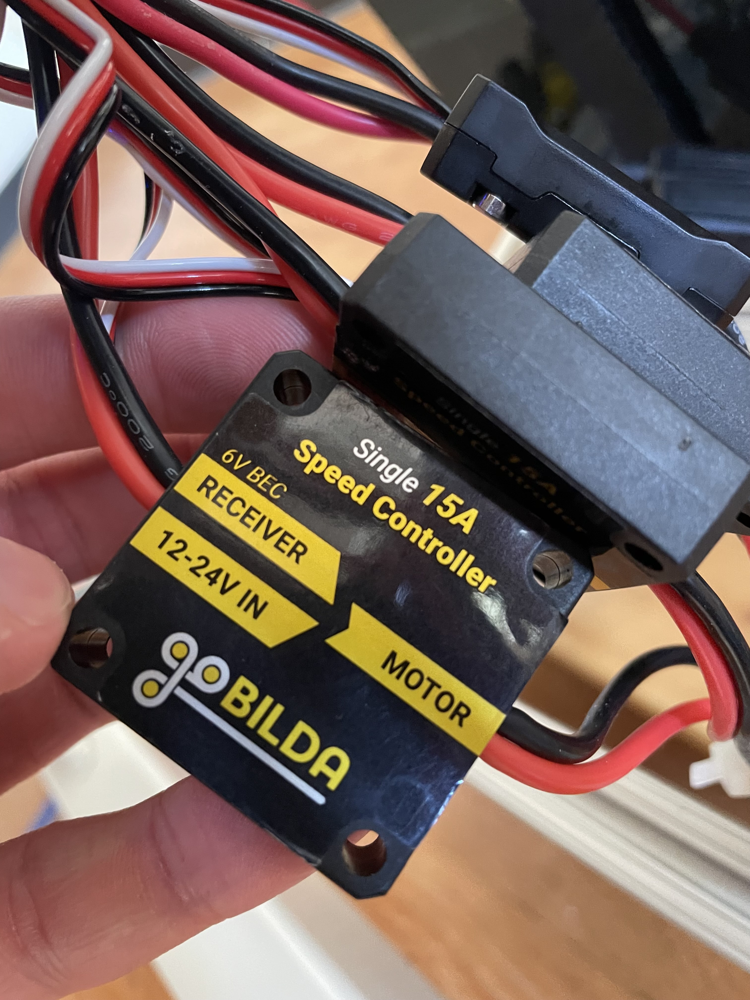

# Sentinel 1 — Hardware Inventory

Status legend:
- ✅ Working (verified by test)
- 🟡 Working (visually verified / prior-team claim, not yet tested)
- ⚠️ Suspect — needs test or repair
- ❌ Broken
- ❓ Unknown / not yet inspected

## 1. Drive Unit (wheels / motors / controller)

| Item | Qty | Status | Notes |
|------|-----|--------|-------|
| GoBilda 5203 Yellow Jacket motor, front-left | 1 | 🟡 | present, not tested. [Product page](https://www.gobilda.com/5203-series-yellow-jacket-planetary-gear-motor-19-2-1-ratio-24mm-length-8mm-rex-shaft-312-rpm-3-3-5v-encoder/) |
| GoBilda 5203 Yellow Jacket motor, front-right | 1 | 🟡 | present, not tested. [Product page](https://www.gobilda.com/5203-series-yellow-jacket-planetary-gear-motor-19-2-1-ratio-24mm-length-8mm-rex-shaft-312-rpm-3-3-5v-encoder/) |
| GoBilda 5203 Yellow Jacket motor, back-left | 1 | 🟡 | present, not tested. [Product page](https://www.gobilda.com/5203-series-yellow-jacket-planetary-gear-motor-19-2-1-ratio-24mm-length-8mm-rex-shaft-312-rpm-3-3-5v-encoder/) |
| GoBilda 5203 Yellow Jacket motor, back-right | 1 | 🟡 | present, not tested. [Product page](https://www.gobilda.com/5203-series-yellow-jacket-planetary-gear-motor-19-2-1-ratio-24mm-length-8mm-rex-shaft-312-rpm-3-3-5v-encoder/) |
| Mecanum wheels | 4 | ❓ | roller condition not checked |
| Gear ratio: 19.2:1, 312 RPM (per product link) | — | 🟡 | verify stamped ratio matches on all 4 |
| GoBilda 1x15A motor controller (9–14V input) | 3 | 🟡 | present, not tested. [Product page](https://www.gobilda.com/1x15a-motor-controller-9-14v-input/) |
| GoBilda 1x20A motor controller (9–30V input) | 1 | 🟡 | present, not tested. [Product page](https://www.gobilda.com/1x20a-motor-controller/) |
| GoBilda Mecanum Mixer | 1 | 🟡 | present, not tested. [Product page](https://www.gobilda.com/mecanum-mixer/). Takes forward+strafe (2ch) from Pico, outputs 4ch to controllers. Photo: `photos/mecanum_mixer_and_power_dist.jpg` |
| Raspberry Pi Pico | ? | ❓ | not yet inspected |

Note: 4 motors, 3x15A + 1x20A — odd mix. Was 20A a replacement? Which wheel? Check.

### Photos

## 2. Power (batteries / circuits)

| Item | Qty | Status | Notes |
|------|-----|--------|-------|
| GoBilda XT30 Power Distribution Board (XT90 input, 8x XT30 outputs) | 1 | 🟡 | present, not tested. [Product page](https://www.gobilda.com/xt30-power-distribution-board-xt90-input-8-x-xt30-outputs/). Photo: `photos/mecanum_mixer_and_power_dist.jpg` |
| Batteries | ? | ❓ | not yet inspected |

## 3. Sensors (LiDAR, cameras, ultrasonic, IMU, encoders)

| Item | Qty | Status | Notes |
|------|-----|--------|-------|
| | | | |

## 4. Compute (Jetson Orin, ESP32, Pi Pico)

| Item | Qty | Status | Notes |
|------|-----|--------|-------|
| | | | |

## 5. Physical Structure

| Item | Qty | Status | Notes |
|------|-----|--------|-------|
| | | | |

## 6. Wiring

| Item | Qty | Status | Notes |
|------|-----|--------|-------|
| | | | |

## 7. Spare Parts (not on robot)

| Item | Qty | Status | Notes |
|------|-----|--------|-------|
| 4-pin JST XH connectors + wires | 4 | 🟡 | for motor encoder ports. Fit not yet confirmed — plug into encoder port to verify |
