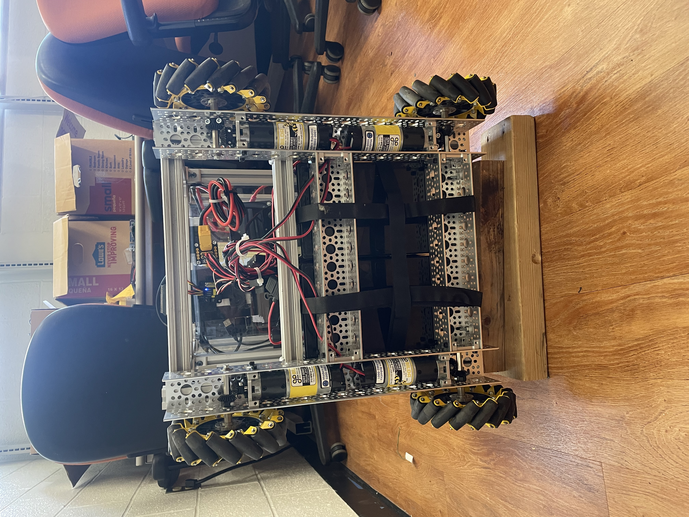
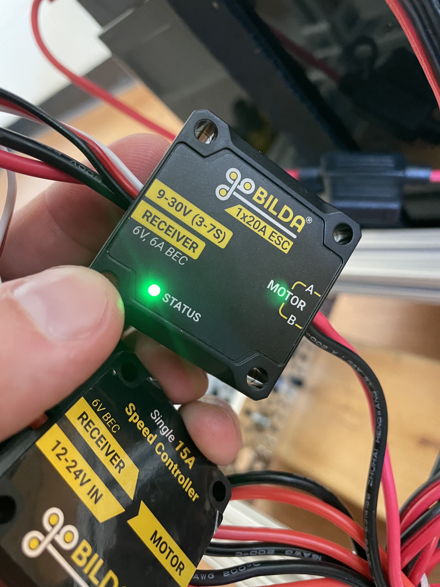
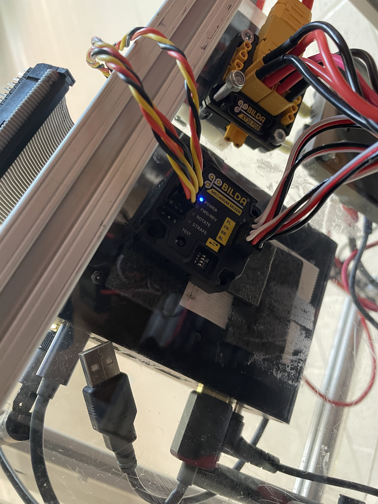

# Sentinel 1 — Hardware Inventory

Status legend:
- ✅ Working (verified by test)
- 🟡 Working (visually verified / prior-team claim, not yet tested)
- ⚠️ Suspect — needs test or repair
- ❌ Broken
- ❓ Unknown / not yet inspected

## 1. Drive Unit (wheels / motors / controller)

| Item | Qty | Status | Notes |
|------|-----|--------|-------|
| GoBilda 5203 Yellow Jacket motor, front-left | 1 | ✅ | spins under Pico+shifter+mixer (blocks, 2026-09-15). [Product page](https://www.gobilda.com/5203-series-yellow-jacket-planetary-gear-motor-19-2-1-ratio-24mm-length-8mm-rex-shaft-312-rpm-3-3-5v-encoder/) |
| GoBilda 5203 Yellow Jacket motor, front-right | 1 | ✅ | spins under Pico+shifter+mixer (blocks, 2026-09-15). [Product page](https://www.gobilda.com/5203-series-yellow-jacket-planetary-gear-motor-19-2-1-ratio-24mm-length-8mm-rex-shaft-312-rpm-3-3-5v-encoder/) |
| GoBilda 5203 Yellow Jacket motor, back-left | 1 | ✅ | spins under Pico+shifter+mixer (blocks, 2026-09-15). [Product page](https://www.gobilda.com/5203-series-yellow-jacket-planetary-gear-motor-19-2-1-ratio-24mm-length-8mm-rex-shaft-312-rpm-3-3-5v-encoder/) |
| GoBilda 5203 Yellow Jacket motor, back-right | 1 | ✅ | spins under Pico+shifter+mixer (blocks, 2026-09-15). [Product page](https://www.gobilda.com/5203-series-yellow-jacket-planetary-gear-motor-19-2-1-ratio-24mm-length-8mm-rex-shaft-312-rpm-3-3-5v-encoder/) |
| Mecanum wheels | 4 | 🟡 | working, visually verified. [Product page](https://www.gobilda.com/140mm-mecanum-wheel-set-70a-durometer-bearing-supported-rollers/) |
| Gear ratio: 19.2:1, 312 RPM (per product link) | — | 🟡 | verify stamped ratio matches on all 4 |
| GoBilda 1x15A motor controller (9–14V input) | 3 | ✅ | wheels spun 2026-09-15 via Pico+shifter+mixer chain. [Product page](https://www.gobilda.com/1x15a-motor-controller-9-14v-input/) |
| GoBilda 1x20A motor controller (9–30V input) | 1 | ✅ | wheels spun 2026-09-15 via Pico+shifter+mixer chain. [Product page](https://www.gobilda.com/1x20a-motor-controller/) |
| GoBilda Mecanum Mixer | 1 | ✅ | verified 2026-09-15: Pico → level shifter → mixer → wheels spin properly (blocks). [Product page](https://www.gobilda.com/mecanum-mixer/). Takes drive+rotate+strafe (3ch, 50Hz servo PWM), outputs 4ch to controllers. Photo: `photos/mecanum_mixer_and_power_dist.jpg` |
| Raspberry Pi Pico | 1 | ✅ | **on robot, driving chain** (2026-09-15). MicroPython `main.py`: 3ch 50Hz PWM GP21/20/19 → shifter → mixer. Serial USB `/dev/ttyACM0` on Orin |

Note: 4 motors, 3x15A + 1x20A — odd mix. Was 20A a replacement? Which wheel? Check.

### Photos

*Front-left motor*

*Front-right motor*

*Back-left motor*

*Back-right motor*

*Underside overview*

*Motor controller 15A #1*

*Motor controller 15A #2*

*Motor controller 15A #3*

*Motor controller 20A*

*Mecanum mixer + XT30 power distribution board*

## 2. Power (batteries / circuits)

| Item | Qty | Status | Notes |
|------|-----|--------|-------|
| GoBilda XT30 Power Distribution Board (XT90 input, 8x XT30 outputs) | 1 | 🟡 | powers Orin + ≥1 motor controller LED. Full load untested. [Product page](https://www.gobilda.com/xt30-power-distribution-board-xt90-input-8-x-xt30-outputs/). Photo: `photos/mecanum_mixer_and_power_dist.jpg` |
| Batteries | ? | ✅ | charge + power Orin verified. Model/capacity not recorded yet — photo needed |

## 3. Sensors (LiDAR, cameras, ultrasonic, IMU, encoders)

| Item | Qty | Status | Notes |
|------|-----|--------|-------|
| RPLidar A1M8 (2D, 360°, 12m) | 1 | ✅ | verified 2026-09-14: CP210x on `/dev/ttyUSB0`, driver OK, health OK, `/scan` @ 10Hz. Must plug into USB-A — Orin USB-C is device mode, no host. [Product page](https://www.adafruit.com/product/4010) |
| RGBD camera — Intel RealSense D435i | 1 | 🟡 | enumerates on USB (8086:0b3a) ✅, streams untested. Has built-in IMU (BMI055) |
| Ultrasonic sensor | ? | ❓ | not yet inspected |
| IMU | 0 | ✅ | **decision 2026-09-14: use D435i built-in IMU, skip standalone IMU order.** Verify rate + mounting |
| Wheel encoders | 4 | 🟡 | built into 5203 motors; wiring/readout unverified |

## 4. Compute (Jetson Orin, ESP32, Pi Pico)

| Item | Qty | Status | Notes |
|------|-----|--------|-------|
| NVIDIA Jetson Orin Nano | 1 | ✅ | boots. Ubuntu 22.04.5, JetPack R36.4.7, ROS2 Humble, ros2_ws builds. `~/.bashrc` sources `/opt/ros/humble/setup.bash` |
| ESP32 | 0 | ❌ | **MISSING — not on robot** (2026-09-14). Firmware source saved on Orin: `ros2_ws/src/sentinel_drive_control/ESP32_code.txt`. Serial protocol + pins documented — portable to Pico. LED strip (NeoPixel) parts of firmware obsolete: no strip on robot, not coming back |
| Raspberry Pi Pico | 1 | ✅ | **on robot, driving chain** (2026-09-15). MicroPython `main.py`: 3ch 50Hz PWM GP21/20/19 → shifter → mixer. Serial USB `/dev/ttyACM0` on Orin |

### Connect to Orin (Mac over USB ethernet)

See `orin_connection.md` (project root). Contains IP + password.

## 5. Physical Structure

| Item | Qty | Status | Notes |
|------|-----|--------|-------|
| | | | |

## 6. Wiring

| Item | Qty | Status | Notes |
|------|-----|--------|-------|
| | | | |

## 7. Spare Parts (not on robot)

| Item | Qty | Status | Notes |
|------|-----|--------|-------|
| 4-pin JST XH connectors + wires | 4 | 🟡 | for motor encoder ports. Fit not yet confirmed — plug into encoder port to verify |
| YF08E level shifter (TXS0108E-style, 8ch) | 1 | ✅ | breadboarded Pico(3.3V)→mixer(5V) signal. Verified through mixer to wheels 2026-09-15 |
